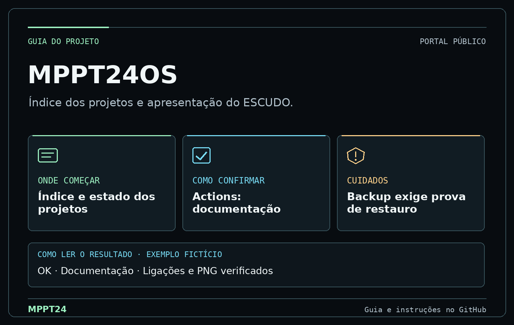

# Guia de MPPT24OS

**Estado:** Portal público.

Índice dos projetos e apresentação do ESCUDO.

[Ver os 16 guias públicos](#guias-dos-reposit%C3%B3rios-p%C3%BAblicos) · [Ler o inventário do ESCUDO em texto](README.md#software-do-escudo-em-texto)

## Onde começar

Escolhe no [catálogo de projetos](#guias-dos-reposit%C3%B3rios-p%C3%BAblicos) ou abre os [exemplos de registos do ESCUDO](#como-ler-um-registo-do-escudo). Para ver o servidor sem instalar software, abre o [infográfico do ESCUDO](README.md#mppt24-escudo).

## Como confirmar

O GitHub regista cada execução dos testes em **Actions**. Abre a execução «Verificar documentação», confirma a data e a versão junto de *Commit*, e abre a etapa que queres ver. Nas execuções concluídas, *Success* indica que todas as etapas obrigatórias passaram. [Ver um ensaio concluído](https://github.com/mppt24/MPPT24OS/actions/runs/44920015000)

## Como ler os registos

Em **Actions**, a tarefa «Cópia temporária e restauro» do workflow «Verificar documentação» cria uma cópia temporária do repositório, restaura-a num segundo diretório e compara o commit. O resultado cobre esse ensaio do Git.

### Exemplo fictício

```text
OK · Documentação · Ligações e PNG verificados
```

Lê pela ordem **resultado**, **etapa** e **detalhe**. Para investigar uma falha, confirma primeiro a data e a versão, depois abre o primeiro passo que falhou.

## Cuidados

O ensaio do Git usa ficheiros temporários. O arquivo histórico e as cópias de segurança do ESCUDO têm percursos próprios. A data do infográfico indica quando o estado foi observado.

O [infográfico do ESCUDO](docs/mppt24-escudo-infografico.png) mostra o estado observado na data indicada no README.

## Como ler um registo do ESCUDO

Os exemplos abaixo são fictícios. No servidor, confirma sempre a hora, a origem do evento e a operação a que diz respeito.

| Área | O que procurar | Como interpretar |
| --- | --- | --- |
| Sistema e serviços | Nome do serviço, resultado e hora | Um serviço parado pode estar inativo por configuração. Uma falha é uma execução que terminou com erro. |
| Rede e acesso | Tipo de evento e resultado | Uma tentativa recusada deve ser lida junto com a origem e o contexto antes de tirar uma conclusão. |
| Cópias e recuperação | Resultado da cópia e teste de restauro | Uma cópia concluída e um restauro verificado são provas diferentes. |
| Monitorização e CORE | Estado e dado que o justificou | `OK` indica que a verificação passou. `WARNING` merece atenção. `ERROR` indica falha na verificação. `UNKNOWN` indica dados insuficientes. |

- **«AVISO · Rede · Dados de conectividade insuficientes».** Confirma se a recolha produziu dados na hora do aviso. Só então dá para avaliar a ligação.
- **«OK · Cópia concluída».** Confirma que a ferramenta terminou a cópia. Procura um registo separado de restauro para saber o que foi recuperado.
- **«ERRO · Serviço · Arranque falhou».** Confirma a hora e o serviço. Procura a primeira mensagem de erro dessa execução para perceber onde falhou.

## Guias dos repositórios públicos

### Começar e experimentar

- [MPPT24](https://github.com/mppt24/mppt24/blob/main/GUIA.md) — Escolher um percurso a partir do perfil.
- [MPPT24OS](https://github.com/mppt24/MPPT24OS/blob/main/GUIA.md) — Índice dos projetos e explicação dos registos do ESCUDO.
- [MPPT24 CORE](https://github.com/mppt24/mppt24-core/blob/main/GUIA.md) — Entender os relatórios e correr os testes da base validada.
- [MPPT24 AGI Absoluta](https://github.com/mppt24/mppt24-agi-absoluta/blob/main/GUIA.md) — Experimentar o chat local, a calculadora e as conversões.
- [AI Hub Publish](https://github.com/mppt24/ai-hub-publish/blob/main/GUIA.md) — Testar a resposta da API local. Em avaliação.
- [AI Hub](https://github.com/mppt24/ai-hub/blob/main/GUIA.md) — Consultar o código e chegar ao guia de teste. Em avaliação.

### Acompanhar o trabalho em curso

- [MPPT24 Bootstrap](https://github.com/mppt24/mppt24-bootstrap/blob/main/GUIA.md) — Preparação do arranque dos componentes.
- [Configuração do servidor](https://github.com/mppt24/mppt24-server-setup/blob/main/GUIA.md) — Esboços das rotinas de configuração e atualização.
- [Rust no Termux](https://github.com/mppt24/rustlinux-termux-installer/blob/main/GUIA.md) — Esboços da verificação do ambiente e da instalação.

### Consultar conceitos, histórico e proveniência

- [MPPT24 AGI Computer](https://github.com/mppt24/mppt24-agi-computer/blob/main/GUIA.md) — Conceito publicado.
- [RustLinux MPPT24](https://github.com/mppt24/RustLinux-mppt24/blob/main/GUIA.md) — Maquete publicada.
- [MPPT24OS · Arquivo](https://github.com/mppt24/MPPT24OS-Backup-2025-08-09/blob/main/GUIA.md) — Cópia de 9 de agosto de 2025.
- [mpptOS](https://github.com/mppt24/mpptOS/blob/master/GUIA.md) — Registo inicial.
- [Teste SSH](https://github.com/mppt24/teste-ssh/blob/main/GUIA.md) — Repositório de teste.
- [LOIC](https://github.com/mppt24/LOIC/blob/master/GUIA.md) — Histórico e proveniência do fork.
- [Slowloris](https://github.com/mppt24/slowloris/blob/master/GUIA.md) — Histórico e proveniência do fork.

O [catálogo JSON](docs/guias.json) contém as mesmas ligações num formato que outras ferramentas podem ler.

## Resumo visual

[](docs/guia-visual.png)
